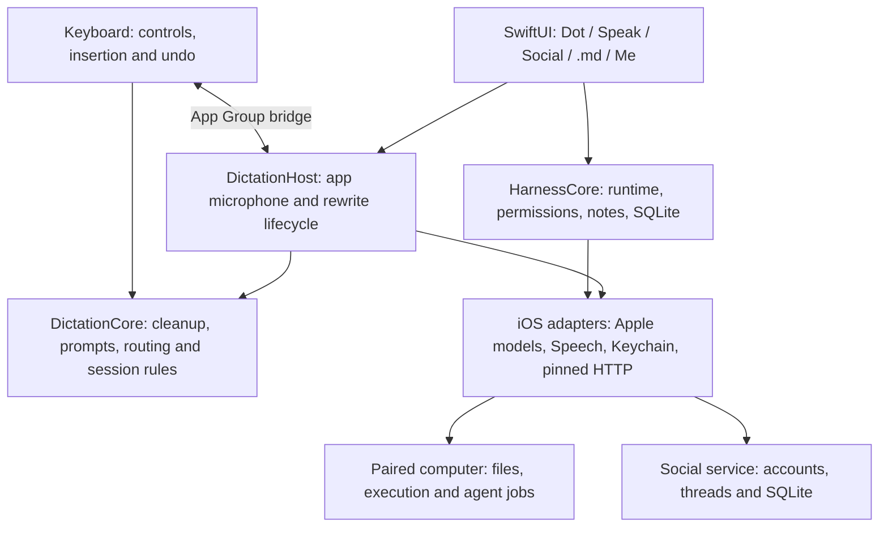

# Harness


**Version 0.1.0 · iOS development build**

Five spaces: **Dot → Speak → Social → .md → Me**. Dot is the General Orchestrator Director conversation; Speak is the dictation keyboard; Social is a purple thread-based network; .md is portable Markdown; Me starts with connections and SSH.

Harness has real functional layers and tested device/service adapters. Signing, subscription products, service configuration and physical-device acceptance are still required before release.

## See the interface


Open [the self-contained interactive preview](preview/harness-preview.html), or serve it:

```sh
python3 -m http.server 4173 --bind 127.0.0.1 --directory preview
```

Visit `http://127.0.0.1:4173`. **Compact** uses five bottom tabs. **Expanded** places workspace left, content center and navigation right. These are responsive layout examples, not device specifications or native screenshots.

The preview supports local drafts/conversations, sample dictation cleanup, Social posts/threads/replies, Markdown editing/search/backlinks/export and disconnected connection profiles. It saves examples in browser local storage. It performs no real recording, inference, SSH, public posting or purchases. See [preview details and captures](preview/README.md).

## Functional layers



`HarnessCore` has no SwiftUI dependency. It owns bounded turns, provider/executor protocols, permissions, notes, persistence and learning. Speak separates portable `DictationCore`, iOS `DictationEngine`, app-side `DictationAppKit` and extension-side `HarnessKeyboardKit`. Credentials stay in Keychain; network/device adapters implement the protocol boundaries. Views consume these functions; model text does not become permissions.

Details: [architecture](docs/ARCHITECTURE.md), [Speak](Packages/HarnessDictation/README.md), [companion](companion/README.md), [Social service](social_service/README.md).

## Implemented behavior

- **Dot:** saved conversations, bounded tool turns, independently permissioned specialists, learning review and an audit trail. Saved pi-coding-agent, Claude Code and Hermes routes use paired computers or their SSH aliases. Approval shows the exact command; a route changed after approval is rejected.
- **Remote jobs:** pinned HTTPS, owner-scoped idempotent start/status/cancel, bounded output and up to 30-minute execution. Results remain for one hour. Jobs are process-local; restarting the companion ends them. Ordinary synchronous commands retain a 60-second limit.
- **Speak:** on-device Apple Speech transcription, an optional configured speech endpoint, local cleanup/dictionary, Fix/Rewrite and insertion/undo. Shared `Speak/instruction.md` controls Polish, Fix and Rewrite, with validated atomic saving and Markdown import/export. Cancellation and field/selection checks protect late results.
- **Apple text models:** local rewriting by default; explicit PCC or local/PCC fallback on iOS 27. PCC is disabled until developer approval/provisioning, then checks runtime availability and quota. Foundation Models edits transcript text; Speech handles transcription.
- **Subscription:** verified StoreKit transactions gate Speak recording/keyboard starts, with purchase/restore/manage, expiry, revocation and verified billing grace. Empty product configuration grants no access.
- **Social:** purple timeline, threads/replies, profiles, following, mutes, likes/reposts, plus a separate persisted service and account/session handling. The direction is broad expression with minimal censorship; deployment policy remains the operator's responsibility.
- **.md:** portable Markdown, search, wikilinks/backlinks, tags, import/export, coordinated saves and conflict checks. Agents read only user-approved folders.
- **Me:** connections/SSH first, followed by models, subscription, intelligence and privacy/activity.

Dot's default Apple adapter is text-only. Tool orchestration requires a configured tool-capable local or OpenAI-compatible provider. Speak's Apple text-editing pipeline is separate.

## Run on iPhone

Requires macOS, **Xcode 26+ and iOS 26+**. Use Xcode 27 for the optional PCC adapter. Open `iOS/Harness.xcodeproj`, select **Harness**, configure your signing team/bundle identifiers, and run on a supported iPhone.

Register the shared `group.org.harness.ios` App Group for your team, or update both entitlement files and group configuration. The project uses local Swift packages, with no third-party Swift dependencies. Regenerate after adding app source files:

```sh
python3 scripts/generate-project.py
xcodebuild -project iOS/Harness.xcodeproj -scheme Harness \
  -sdk iphonesimulator -destination 'generic/platform=iOS Simulator' \
  CODE_SIGNING_ALLOWED=NO build
```

Configure models in **Me → Models & providers**. Keys use Keychain; remote endpoints require HTTPS and reject credentialed redirects. Pair machines through **Me → Connections & SSH** using the [companion instructions](companion/README.md).

Populate `HarnessSubscriptionProductIDs` with real auto-renewable App Store Connect IDs to enable paid Speak. For PCC, obtain [Apple's approval and entitlement](https://developer.apple.com/private-cloud-compute/), configure provisioning, then enable `HarnessPrivateCloudEnabled`. Local flags and example IDs do not grant real entitlements.

## iOS dictation restrictions

The **app owns the microphone**. The keyboard sends App Group commands and inserts returned text. Full Access does not grant microphone access. Secure fields use Apple's keyboard, and apps may reject custom keyboards.

Start Speak in Harness or with its **Start Speak** shortcut, then return to the text field. A warm session can avoid repeated switching while iOS permits it. The microphone stays active with the orange system indicator until stopped or expired. Cold sessions and interruptions need recovery; permanent background recording is not promised.

The responder-chain keyboard-to-app URL path is experimental, not a supported extension API or proof of App Review acceptance. Manual/shortcut activation and microphone-to-field behavior need physical testing. See [device QA](Packages/HarnessDictation/docs/QA_CHECKLIST.md) and [draft review notes](Packages/HarnessDictation/docs/APP_REVIEW.md).

## Verification

```sh
swift test
swift test --package-path Packages/HarnessDictation
PYTHONPATH=companion python3 -m unittest discover -s companion/tests -v
python3 -m unittest social_service.test_service -v
python3 -m social_service.test_swift_client --scratch-path /tmp/harness-social-client
node --test preview/model.test.cjs
```

macOS uses Xcode's Swift compiler. Linux requires Swift 6.2, SQLite headers, Python 3.11+ and OpenSSL. Two Social HTTP tests intentionally skip in a plain core run; the fixture runner starts an isolated real service and exercises them explicitly.

The updated native app/keyboard passed unsigned simulator and iPhone Xcode builds. Speak's portable suite passed 109 tests, and an actual local Apple model preserved a synthetic correction. These checks do not prove physical recording/insertion, App Store transactions, PCC eligibility or production services. GitHub CI covers core, dictation and companion checks, with native builds on macOS; the Social service/client and preview checks above also passed locally.

## Remaining setup

- Signing/App Group, real subscription products and physical cold/warm recording, interruption, insertion/undo and layout testing.
- PCC developer approval for optional cloud text editing.
- A deployed HTTPS Social origin/account and operator policy.
- Paired machines with installed/authenticated agents and known SSH hosts. Manual recovery controls for a retained job after its turn ends are not exposed yet.
- Paired-computer STT, hosted speech infrastructure and Diction-style remote audio streaming remain disconnected. BYO cloud STT and on-device live partials are already implemented separately.

Director work cancels when the app backgrounds. Companion execution is separately granted computer-user access, not a filesystem sandbox. Sessions/audits use iOS data protection rather than custom database encryption. No analytics SDK, telemetry endpoint or embedded credential is included.

Licensed under Apache 2.0. The selected horse artwork is preserved exactly as supplied for the logo and icon.
