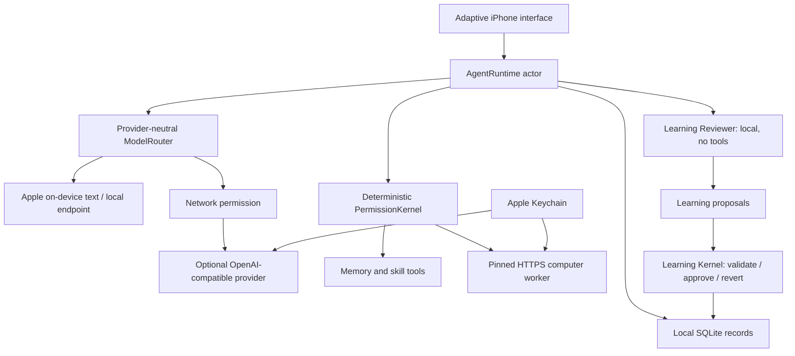

# Harness architecture

The phone owns the session, user context, approval UI and credentials. Models request operations; trusted host code checks them. The UI does not parse model text into permissions, and neither skill text nor model output can change capability rules.

## Runtime and context

`HarnessCore` is a Swift package with no SwiftUI dependencies. Actors serialize database updates and runtime state. Each turn reserves its session before awaiting, persists user input, loads a current agent profile, assembles separately labeled context files, retrieves relevant skill metadata, chooses an available provider, and requests consent before cloud inference. Tool calls run sequentially with bounded rounds/call counts. Interrupted calls receive explicit incomplete results so a resumed context does not contain orphan tool calls.

The current router supports explicit local-only, local-first Balanced, and cloud-first preferences. There is no silent switch from a failed local inference to a cloud API. The Apple adapter reports that tools are unavailable instead of simulating actions. OpenAI-compatible endpoints handle actual structured tool calls. Anthropic/Gemini native protocols can later conform to `ModelProvider`; they are not implemented as direct native clients today.

The core includes only tools actually implemented by the client. No unrestricted browsing or Apple integration is advertised. Paired computer IDs and granted capabilities are made available to a tool-capable model without credential material.

## Permissions and credentials

Every tool has a capability and risk level. A live agent capability ceiling and saved user denials are checked before and after awaited approval. Low-risk built-in local reads may be allowed; external profiles ask. Sensitive actions always require the host's biometric flow, even if a previous broad allow rule exists. An authorization handler is an injected trusted-host boundary, never an LLM callback.

Provider and companion tokens are stored in Keychain with device-only accessibility. Model context and the SQLite state contain provider configuration and certificate fingerprints, never raw API keys or bearer credentials. Network sessions are ephemeral and refuse redirects to prevent credential forwarding. Companion connections validate the exact QR certificate fingerprint, hostname, dates and TLS policy.

Phone grants are a subset of the node's independently configured capabilities. Pairing starts with read access only where the node supports it. Revoking phone grants stops future agent requests; revoking a companion bearer credential requires the node's revoke command. Already executing authorized requests cannot be undone by changing a toggle.

## Learning

The Learning Reviewer receives bounded evidence and context, and uses only a local provider without tools. If no local model is available, the fallback proposes only explicit first-person preference statements. It cannot invoke the external executor or inherit GOD's capabilities. Model-proposed memory/skill changes remain data until the Learning Kernel validates and applies them.

Ask Me is the default. Approved changes compare the original content inside an atomic store update; stale proposals fail instead of overwriting later edits. Journey stores before/after content and guards reversions similarly. New learned skills are disabled with local-read-only requirements. Their Markdown cannot grant capabilities, and skill procedure loading remains separate from native execution.

## Storage and privacy evidence

SQLite transactions commit session, learning and audit changes together. Collections use typed Codable records. Invalid data is reported and preserved; the app does not silently reset the user's store. The iOS database directory and files use data protection; credentials use Keychain independently.

Activity distinguishes context prepared for an authorized request from a successful provider response. It records selected message context, tool inputs/results, permission decisions, provider/token metadata when reported, and learning outcomes. These are application observations, not packet captures. An authorized request can fail without establishing delivery; a successful response still cannot prove remote retention practices. No model interpretation alone establishes security.

## iPhone-first presentation

The app target is iPhone on iOS 26+. Compact widths show GOD/Agents/Red/Me tabs; expanded widths show the same navigation in a sidebar. Layout follows available geometry rather than model-name checks. Native safe areas, scrolling and Dynamic Type are used. Device eligibility is discovered through Apple APIs, and unavailable model/camera paths have explicit UI states.

The source does not assume unannounced dimensions, hinges, split-screen modes or model capabilities for iPhone 18 Pro or iPhone Duo. Physical-device validation is necessary once those targets are available. The app cancels active work on backgrounding; long-running jobs belong on an explicitly paired worker in a later durable task protocol.
