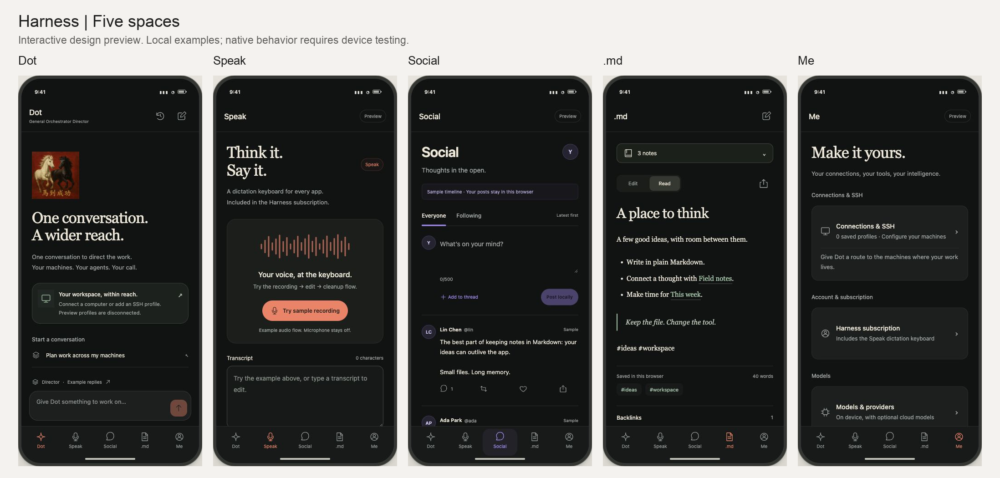
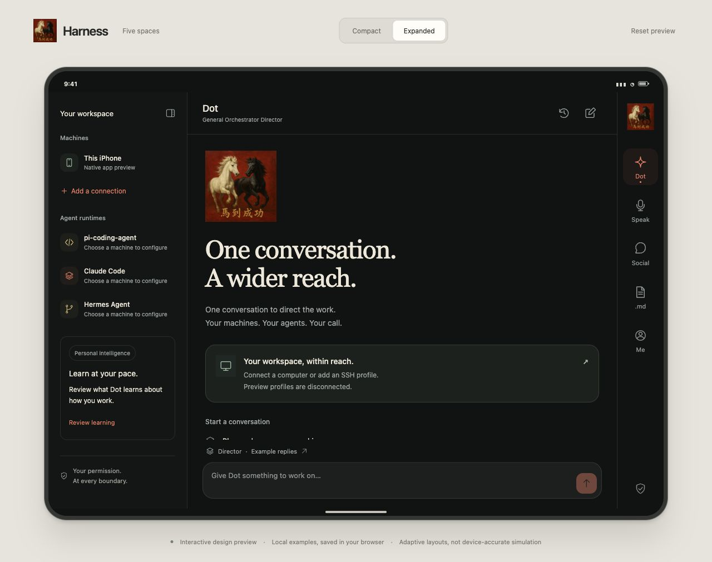

# Harness five-space preview

Open `harness-preview.html` in a browser. This portable file includes all styles, icons, state, interactions, and the full approved horse-painting logo. The original logo bytes are embedded once and reused for the favicon, wordmark, navigation, and Dot hero; the artwork and 馬到成功 lettering are shown without cropping. Or serve the source preview:

```sh
python3 -m http.server 4173 --directory preview
```

Open `http://localhost:4173`. The primary spaces are **Dot → Speak → Social → .md → Me**. Expanded layout places the workspace on the left, content in the middle, and navigation on the right. Compact layout uses a five-item bottom bar. Narrow browser windows also use the compact shell.

## What to try

- **Dot:** type a draft and change spaces or widths; send an example prompt, choose a runtime route, archive a conversation with New conversation, and reopen it from history. The main conversation is the General Orchestrator Director. Runtime profiles cover pi-coding-agent, Claude Code, and Hermes Agent.
- **Speak:** start and stop a sample recording, edit its transcript, apply deterministic filler cleanup, undo it, and insert the result in the example text field. Edit the shared `instruction.md` preview, import/export UTF-8 Markdown, and select the explicit text-rewrite route. Drafts survive navigation, saved instructions are limited to 8 KB, and route selections make no model calls. View native keyboard setup, cold/warm microphone-session guidance, secure-field/app restrictions, and the Harness subscription inclusion. The preview does not use the microphone or verify Apple Private Cloud capability or a subscription entitlement.
- **Social:** compose a post or multi-part thread, post locally, reply, like, repost, view profiles, follow a sample person, and switch the chronological timeline between Everyone and Following. Drafts and actions persist locally. The minimal-censorship product direction is explained separately from feed order; no public moderation policy is claimed as implemented.
- **.md:** search notes or tags, switch between editing and reading, follow wikilinks, inspect backlinks, create notes, and export portable Markdown. User text is escaped before rendering. Raw HTML and unsafe link schemes remain text. Markdown supports headings, lists, task items, blockquotes, emphasis, code, safe HTTP(S) links, and wikilinks.
- **Me:** Connections & SSH comes first, then subscription, models, personal intelligence, and privacy. Add and edit non-secret SSH profile details; saved profiles always remain disconnected. Review or revert a sample learning preference.

The examples use browser local storage, including drafts, notes, posts, and connection profiles. Reloading preserves changes when storage is available. Reset preview asks before clearing data. Private browsing or local-file storage restrictions may limit persistence to the current tab; Privacy reports that state. Sample people and conversations are demonstrations. No model requests, public social service, analytics, SSH sessions, real microphone recording, native keyboard handoff, or purchases are implemented in this browser preview.

This is an interactive design preview alongside the native SwiftUI app. It does not prove physical-device dictation, App Store entitlements, native agent connections, or a deployed public social service. The approved two-horse painting is the product logo; its original image and Chinese lettering are preserved.

## Rebuild and verify

Edit `index.html`, `style.css`, `model.js`, and `app.js`, then run:

```sh
python3 scripts/build-preview.py
node --check preview/app.js
node --check preview/model.js
node --test preview/model.test.cjs
```

The state tests cover draft restoration, chronological filtering, threads/replies, invalid posts, wikilinks/backlinks/search, and Markdown injection resistance. `showcase.html` displays compact and expanded previews together.

## Current captures

Captured October 13, 2026 from the rebuilt portable preview, using a fresh browser origin and the Compact/Expanded controls. These show the actual rendered preview; they are not native-device screenshots. The five-space sheet combines unchanged screen crops from the same browser size.





Individual compact captures: [Dot](harness-iphone.png), [Speak](harness-speak.png), [Social](harness-social.png), [Markdown](harness-markdown.png), [Me](harness-me.png).
